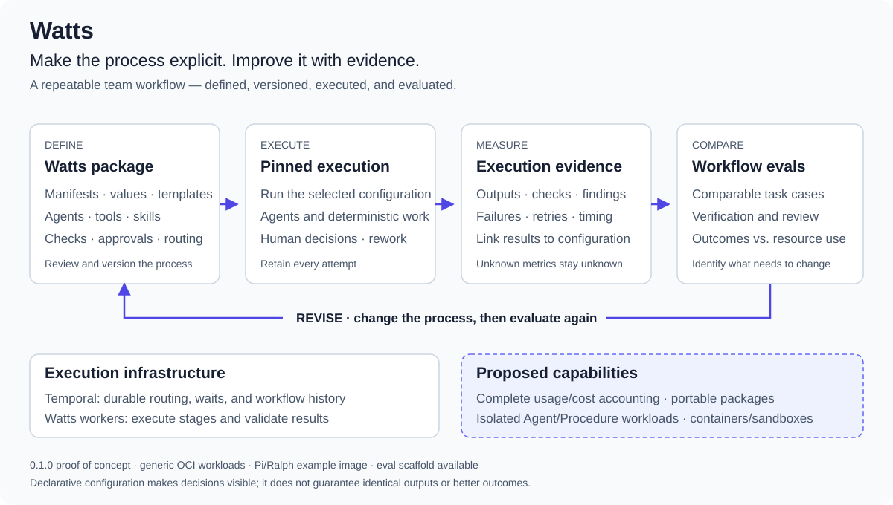

# Watts



*Define → execute → measure → compare → revise. Dashed capabilities are proposed; see [stage communication](docs/stage-communication.md).*

**Define, run, evaluate, and improve a repeatable process for agent work.**

A team cannot reliably improve a process it cannot describe. When each engineer improvises prompts, tools, checks, and review, a successful result is difficult to explain or reproduce. Was it the model, the instructions, the verification, extra human intervention, or luck?

Watts makes that process explicit and executable. Declarative manifests define the work, agents, tools, checks, approvals, and routing. Values-driven templates package those choices so teams can share a common workflow and customize it for their needs. The process becomes something a team can review, version, and deliberately change.

**Define → execute → measure → compare → revise.**

Templates describe the intended process. Pinned execution definitions and attempt evidence show what actually ran. Evals connect a particular configuration to its outcomes and resource use. Together, they provide a basis for improving the workflow instead of relying on isolated successes or intuition.

The goal is an auditable, portable process that teams can maintain over time: change a review policy, skill, model, or quality gate; run comparable cases; inspect the results; and decide whether the change helped. Declarative configuration makes those choices visible. It does not guarantee identical agent output or better results by itself.

## Current implementation

The Watts CLI is named `wctl`. Package names, manifests such as `watts.yaml`, and `.watts` state directories retain the Watts name.

Watts runs configurable coding workflows with AI agents, human review gates, and automated checks. YAML resources compose Workflow, Procedure, Agent, MCP, ConfigMap, and Secret definitions; see [Kinds and usage](docs/kinds.md). Temporal manages durable workflow state; project workers execute Agent and Procedure workloads in a container execution environment. The currently supported backend is a local Docker Engine; Podman and Kubernetes are potential future backends, not supported integrations. Pi/Ralph is an example workload image.

This is an MVP and proof of concept at **0.1.0**. Pinned definitions, attempt evidence, and an [eval scaffold](evals/go-workflow/README.md) exist, but complete token/cost accounting, distributed execution, and hardened multi-tenant isolation remain work in progress. Local container execution, reattachment, and conflict-aware publication are implemented. See [known issues](issues.md), the [stage communication proposal](docs/stage-communication.md), and the [package/runtime layout proposal](docs/package-runtime-layout.md). Watts does not require Git.

## Get started

You need Go 1.27 or later to build Watts and a running Temporal server. Build or pull the images selected by your manifests on the worker's local Docker engine. See the [runbook](docs/runbook.md) for prerequisites and provider setup.

From this checkout, build Watts and start local Temporal with Docker Compose:

```sh
make build
docker compose up -d --wait
docker build -t watts/pi-ralph:0.1.0 registry/pi_ralph
docker build -t watts/coder-golang:0.1.0 registry/coder_golang
```

The build produces `bin/wctl`; `make install` installs it to `/usr/local/bin`. Ensure the installation directory is on your `PATH`. Temporal can also run remotely; see [Temporal setup](docs/temporal.md).

From the project directory where you want application work performed:

```sh
wctl template new team-workflow
# Customize team-workflow/values.yaml and build its declared images.
wctl doctor --package ./team-workflow/watts.yaml
wctl start -d
```

The bundled workflows currently select `deepseek/deepseek-v4-flash` through OpenRouter. Export `OPENROUTER_API_KEY` in the shell **before starting Watts**. Configure another provider or model through [project configuration](docs/runbook.md#configure-the-project) and [workflow templates](docs/workflows.md).

`wctl start` starts the project's worker and web UI, opens your default browser, and stays in the foreground. Use `-d` to detach and `wctl stop` to stop both. Detached logs are in `.watts/service.log`. Temporal is managed separately.

## Complete a task

```sh
wctl task new hello-server --package ./team-workflow/watts.yaml
```

Use the task path printed by the command. Write the request or rough notes in its `SPEC.md`. The task's `workflow.yaml` is a resolved snapshot: customize source values/templates before creating the task, rather than editing rendered output.

```sh
wctl task run <task>
wctl task status <task>
```

The scaffolded package is a small build/check example. For the full specification, planning, approval, build, and review process with Agent quality gates, use the [Golang coder package](resources/examples/coder_golang/README.md).

When the workflow pauses for human review, inspect the document and approve it:

```sh
wctl task decide <task> spec-review
# Later, when planning is ready:
wctl task decide <task> plan-review
```

To request changes, add `--reject --feedback "Changes needed"`. Agent review can return work to build.

Task submission returns before execution finishes. Follow progress in the web UI or with `task status`. If a stage fails, inspect its error and output, then use `wctl task run <task>` or the UI's retry button. Submitted workflow definitions and runtime configuration are pinned; retry does not load subsequent edits.

See the [task runbook](docs/runbook.md) for the full procedure, approval rules, cancellation, and recovery.

## Current project layout

The application workspace stays separate from package authoring. With `--package`, task creation uses the invocation directory as the project root, even when the package is external. Without it, a root `watts.yaml` selects the package.

- Package descriptor, values, templates, and assets: authored workflow configuration.
- `.watts/`: local worker state and captured package assets; operational preferences are in `.watts/settings.yaml`.
- `tasks/<task>/`: `SPEC.md`, `PLAN.md`, resolved `workflow.yaml`, review documents, logs, and execution evidence.

Workload-private settings and tool state live under `~/.watts/runtime/`, outside the application workspace. There is no initialization or host agent installation command. The [runbook](docs/runbook.md) explains explicit dependency provisioning. The proposed consolidated `watts/` package and home-directory runtime layout remain tracked in [wiss-028](issues.md#wiss-028-separate-watts-packages-task-executions-and-worker-runtime).

## Documentation

The [documentation index](docs/README.md) groups guides by task.

| Document | Covers |
| --- | --- |
| [Runbook](docs/runbook.md) | Setup, configuration, task execution, and recovery |
| [Kinds](docs/kinds.md) | Resource definitions, references, shared defaults, and credentials |
| [Workflow execution](docs/workflows.md) | Routing, results, events, and MCP tools |
| [Templating](docs/templates.md) | Values-driven packages and rendering |
| [Go team example](resources/examples/coder_golang/README.md) | Custom workflow, skills, gopls, and lint |
| [Temporal](docs/temporal.md) | Infrastructure, workers, durable execution, and recovery |
| [Web UI](web/readme.md) | Task monitoring, output, and retry controls |
| [Agent resources](resources/readme.md) | Coordinator skill and supporting resources |
| [Go workflow eval](evals/go-workflow/README.md) | Repeatable task cases, human scoring, and comparison records |
| [CLI organization](cli/readme.md) | Command-layer structure |
| [Workflow design](docs/workflow-design.md) | Architecture and design rationale |
| [Stage communication](docs/stage-communication.md) | Proposed stage interfaces and build/review feedback |
| [Sandboxing](docs/sandbox.md) | Isolation considerations |
| [Issues](issues.md) | Known problems, proposed improvements, and design questions |

## Development

Run the repository checks:

```sh
go test ./...
```

Rebuild Watts and restart its service after changing the implementation. Tests validate software behavior; the [eval scaffold](evals/go-workflow/README.md) supports evaluating a configured workflow's results over time.

## License

[MPL 2.0](LICENSE). Third-party dependencies and attributed material retain their respective licenses.
