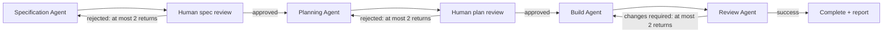

# Golang coder package

A team workflow for Go business applications and web services, authored in ACL.
It demonstrates generic container Agents, human approvals, required quality
gates, skills, and reusable provider/MCP modules. Source follows the
[ACL style skill](../../skills/acl-style/SKILL.md).

| File | Purpose |
| --- | --- |
| `watts.acl` | Package identity, assets, and declared variable files |
| `variables.acl` | Documented typed package inputs |
| `modules.acl` | Provider, Go tools, and MCP module composition |
| `values.wvars` | Image, provider, model, API, reasoning, and credential-source defaults |
| `agents.acl` | Specification, planning, build, and review Agent contracts |
| `procedures.acl` | Human spec and plan approval Procedures |
| `workflow.acl` | Stage order, named artifact connections, and bounded routes |
| `modules/provider/` | Named provider credential sources backed by the worker environment |
| `modules/gopls/` | Reusable gopls MCP service |
| `modules/go-tools/` | Command capabilities shared by build and review |
| `prompts/` | Agent instructions, private Ralph configuration, and task scaffolds |
| `skills/`, `scripts/`, `.golangci.yml` | Team guidance and quality checks captured in the artifact |

The default image is `watts/coder-golang:0.1.0`; model/provider settings come from
`values.wvars`. Read and adjust that file before using the example. Credentials
remain in the worker environment. The compiled artifact records source bindings,
not key values.

## Compile and run

From the Watts checkout, build its selected images as described in
[the runbook](../../../docs/runbook.md). Compilation is independent of runtime:

```sh
wctl compile ./resources/examples/coder_golang -o /tmp/coding.json
wctl c ./resources/examples/coder_golang \
  -var-file /path/to/team.wvars -o /tmp/coding.json
```

From an application project such as `../test`:

```sh
wctl new ./watts --from /path/to/watts/resources/examples/coder_golang
# Edit watts/values.wvars for each Agent and named provider profile.
export OPENROUTER_API_KEY='your-key'
wctl start -d
wctl exec ./watts --name 'Hello server' --request-file request.md
```

Use `--request 'Create a minimal Go HTTP server.'` for a short request, or
`--request-file -` for stdin. `exec` compiles and captures a new task directly.
Explicit compiled-artifact execution remains supported. The capture includes
scripts and skills, so retries do not depend on the source checkout remaining
available and do not reload changed ACL.

## Workflow



SPEC describes what and why; PLAN describes approach and sequence. Agents refine
these documents. Human approvals bind to the exact reviewed attempt and artifact
hashes. Implemented application code belongs in the project root and its normal
source directories, not the task directory.

The builder runs compile, Go tests, vet, golangci-lint, and story validation as
Agent tools and formal gates. There is no separate lint stage. The review Agent
has a read-only workspace and verifies the candidate. The image supplies Go,
lint, Pi/Ralph, and gopls; Watts does not install host software.

## Reuse and customization

`wctl new ./watts --from <this-package>` generates the importing package and its
editable typed inputs. It creates files only and keeps an explicit local module
reference; it does not copy the dependency. For manual composition, use the whole
package as a local module with an explicit entrypoint:

```hcl
package "team" {
  version    = "0.1.0"
  var_files  = ["values.wvars"]
  entrypoint = module.coder.workflow.coding
}

module "coder" {
  source    = "../watts/resources/examples/coder_golang"
  version   = "0.1.0"
  variables = {
    agents    = var.agents
    globals   = var.globals
    providers = var.providers
  }
}
```

Declare the same typed `agents`, `globals`, and `providers` inputs in the consuming
package (copy `variables.acl`) and load your own `values.wvars` with
`package.var_files = ["values.wvars"]`. Module inputs are explicit; parent values
do not automatically flow into dependencies.

### Independent Agent settings

`values.wvars` has three namespaces, using ordinary ACL object variables:

- `providers`: profiles keyed by provider name, grouping `base_url`, `api`, and
  `api_key_env`. Add your own OpenAI-compatible endpoint here and export its key
  in the worker environment. These are environment variable **names**, not keys.
- `agents`: required entries `specification`, `planning`, `build`, and `review`.
  Each chooses its provider profile, model ID, thinking setting, optional image
  override, context window, output token limit, and reasoning capability.
- `globals`: a shared image. Each Agent's ACL explicitly selects this image when
  that Agent's `image` is empty. Nothing else inherits implicitly.

For example, add a `corporate` profile alongside `openrouter`:

```hcl
corporate = {
  api         = "openai-completions"
  api_key_env = "CORPORATE_API_KEY"
  base_url    = "https://models.example.com/v1"
}
```

Then replace the `review` entry within `agents`:

```hcl
review = {
  provider          = "corporate"
  model             = "your-review-model"
  thinking          = "high"
  image             = "your-team/reviewer:0.1.0"
  context_window    = 64000
  max_output_tokens = 8000
  reasoning         = true
}
```

The other three Agents keep their own selections. Model limits/capabilities are
passed to the Pi image's `model_config`; use values supported by your model.
`thinking` is the image adapter's setting. Choose an empty value for models that
do not support reasoning controls. An Agent image must implement the configured
launcher contract; changing an image is not a universal adapter conversion.

Override files replace each supplied top-level variable in full: an `agents`
override supplies all four entries, with no deep merge. Missing Agent entries,
provider references, or required fields fail compilation. Source credentials are
resolved only at execution; compiled definitions retain independent Secret
bindings. Existing tasks keep their captured configuration.

A team can also export selected Agents from its own module and stitch them into
an independent workflow. Named outputs connect task artifacts; routing controls
feedback separately. Edit Agent contracts and team policy directly in ACL.
See [the ACL language specification](../../../docs/language-spec.md).

Current limits: local modules and Docker execution only; model/cost/tool telemetry
may be incomplete. Gate success and workflow completion do not replace independent
acceptance evaluation. Compare configurations against the same cases, rubric,
and intervention policy over time. Cases and retained runs live in the separate
`evals` project under `go-workflow/`; the [task-report guide](../../../docs/task-reports.md)
explains available measurements.

## Project and worker storage

Keep authored ACL, values, modules, and resources under your project's `watts/`
or compile this example externally. `-workflow coding` selects this example's
named workflow. Task creation captures package assets under the task's private
state; it does not create a project `.watts/` cache. Worker preferences and runtime
files live under `~/.watts/`, shared across projects with isolated project/run
identities. See [storage layout](../../../docs/package-runtime-layout.md).
