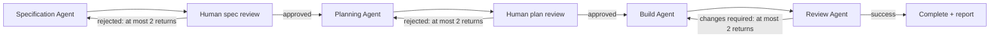

# Golang coder package

A team workflow for Go business applications and web services, authored in ACL.
It demonstrates generic container Agents, human approvals, required quality
gates, skills, and reusable provider/MCP modules. Source follows the
[ACL style skill](../../skills/acl-style/SKILL.md).

| File | Purpose |
| --- | --- |
| `watts.acl` | Package identity, assets, and declared variable files |
| `variables.acl` | Documented typed package inputs |
| `modules.acl` | Provider, Go tools, and MCP module composition |
| `values.wvars` | Image, provider, model, API, reasoning, and credential-source defaults |
| `agents.acl` | Specification, planning, build, and review Agent contracts |
| `procedures.acl` | Human spec and plan approval Procedures |
| `workflow.acl` | Stage order, named artifact connections, and bounded routes |
| `modules/provider/` | Reusable provider defaults and environment-backed Secret |
| `modules/gopls/` | Reusable gopls MCP service |
| `modules/go-tools/` | Command capabilities shared by build and review |
| `prompts/` | Agent instructions, private Ralph configuration, and task scaffolds |
| `skills/`, `scripts/`, `.golangci.yml` | Team guidance and quality checks captured in the artifact |

The default image is `watts/coder-golang:0.1.0`; model/provider settings come from
`values.wvars`. Read and adjust that file before using the example. Credentials
remain in the worker environment. The compiled artifact records source bindings,
not key values.

## Compile and run

From the Watts checkout, build its selected images as described in
[the runbook](../../../docs/runbook.md). Compilation is independent of runtime:

```sh
wctl compile ./resources/examples/coder_golang -o /tmp/coding.json
wctl c ./resources/examples/coder_golang \
  -var 'model="your-provider/model"' -o /tmp/coding.json
```

From an application project such as `../test`:

```sh
export OPENROUTER_API_KEY='your-key'
wctl doctor --compiled /tmp/coding.json
wctl start -d
wctl task new hello-server --compiled /tmp/coding.json
# Draft the printed task's SPEC.md, then:
wctl exec tasks/<printed-task-name>
```

Or start immediately with `wctl exec /tmp/coding.json --name hello-server
--request 'Create a minimal Go HTTP server.'`. The artifact includes scripts and
skills, so execution does not depend on the source checkout remaining available.
Source edits require recompilation and a new task.

## Workflow



SPEC describes what and why; PLAN describes approach and sequence. Agents refine
these documents. Human approvals bind to the exact reviewed attempt and artifact
hashes. Implemented application code belongs in the project root and its normal
source directories, not the task directory.

The builder runs compile, Go tests, vet, golangci-lint, and story validation as
Agent tools and formal gates. There is no separate lint stage. The review Agent
has a read-only workspace and verifies the candidate. The image supplies Go,
lint, Pi/Ralph, and gopls; Watts does not install host software.

## Reuse and customization

Use the whole package as a local module with an explicit entrypoint:

```hcl
package "team" {
  version    = "0.1.0"
  entrypoint = module.coder.workflow.coding
}

module "coder" {
  source    = "../watts/resources/examples/coder_golang"
  version   = "0.1.0"
  variables = { model = "your-provider/model" }
}
```

A team can also export selected Agents from its own module and stitch them into
an independent workflow. Named outputs connect task artifacts; routing controls
feedback separately. Edit Agent contracts and team policy directly in ACL.
See [the ACL language specification](../../../docs/language-spec.md).

Current limits: local modules and Docker execution only; model/cost/tool telemetry
may be incomplete. Gate success and workflow completion do not replace independent
acceptance evaluation. Use [comparable evals](../../../evals/go-workflow/README.md)
to assess changes to this team's configuration over time.
