# Golang coder workflow

This diagram represents the default policy in [workflow.acl](workflow.acl). Teams can change the stages and routes through ACL/modules before compiling a new artifact.

```mermaid
flowchart LR
    Request["Initial request in SPEC.md"] --> Spec["Specification · Agent<br/>Refine SPEC.md<br/>Required gate: spec-valid"]
    Spec --> SpecReview{"Spec review · Procedure<br/>Human decision on SPEC.md"}
    SpecReview -->|approved| Plan["Planning · Agent<br/>Write PLAN.md<br/>Required gate: plan-valid"]
    SpecReview -->|rejected + feedback: max 2 returns| Spec
    Plan --> PlanReview{"Plan review · Procedure<br/>Human decision on SPEC.md + PLAN.md"}
    PlanReview -->|approved| Build["Build · Agent<br/>Implement in the project workspace<br/>Publish STORY_LOG.md<br/>Required gates: build, test, vet, lint, stories"]
    PlanReview -->|rejected + feedback: max 2 returns| Plan
    Build --> Review["Review · Agent<br/>Inspect the application read-only<br/>Publish review/VERDICT.md<br/>Required gate: verdict-valid"]
    Review -->|"success · PASS"| Complete["Workflow completed"]
    Review -->|"changes-required · REJECT: max 2 returns"| Build

    classDef agent fill:#f3f6f8,stroke:#536879,color:#202830;
    classDef approval fill:#faf7ef,stroke:#8a7954,color:#202830;
    classDef boundary fill:#ffffff,stroke:#8b969f,color:#202830;
    class Spec,Plan,Build,Review agent;
    class SpecReview,PlanReview approval;
    class Request,Complete boundary;
```

There are **six workflow stages**. Specification, planning, build, and review are Agents; spec-review and plan-review are approval Procedures. The checks shown inside Agent boxes are completion gates, not additional workflow stages. There is no separate lint stage.

## Within an Agent attempt

- Specification and planning permit the default two gate repair passes. Build explicitly permits two. These repairs happen within the same container execution; they are distinct from workflow-stage retries and the image's Ralph iterations.
- Build exposes command tools for compilation, Go tests, vet, lint, and story validation, plus gopls MCP and named skills. All five completion gates must pass against the final candidate before its outputs are accepted. Build products and caches belong under private runtime storage.
- Review can call test, vet, and lint, but its formal required gate checks the verdict format. A valid REJECT verdict routes findings back to build. A failed test is not automatically a failed review execution. Review has zero gate repair passes.

## Errors and decisions

Execution errors, missing/invalid artifacts, or exhausted gate repair fail the current stage. These default placements declare no `on_failure` route, so Watts waits for an explicit retry (`waiting_retry`). `wctl exec <task>` creates another attempt at that stage using the pinned configuration. It does not jump to an arbitrary stage or reload edited ACL.

Human decisions are bound to the pending placement, attempt, and input hashes. Rejection returns to the declared authoring stage with feedback; it is different from an execution error. Review's valid REJECT maps to `changes-required`, while PASS maps to `success`.

Temporal retains routing, approval/retry waits, and attempt history. Watts workers execute the declared workloads and retain evidence. Current execution uses local Docker; this diagram does not imply distributed scheduling or automatic Git publication.
